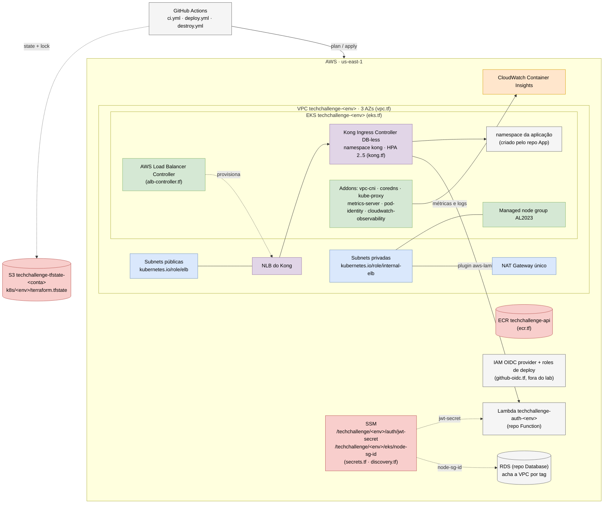

# Tech Challenge - Infraestrutura Kubernetes (Terraform)

**Repositório 2 do projeto.** Infrastructure as Code (Terraform) da camada
Kubernetes na AWS: **VPC, ECR, EKS, addons, ALB Controller, Kong (API Gateway) e
IAM/OIDC**. Todo o ciclo de vida (criar, atualizar e destruir) é versionado aqui
e executado pelo **GitHub Actions**, com o state no S3 e um ambiente por branch
(`develop` → staging, `main` → produção).

> Documentação arquitetural geral (diagrama de componentes, sequências, RFCs, ADRs e modelo
> de dados): **[tech-challenge-docs](https://github.com/Jean-Carlo-Torres/tech-challenge-docs)**.

## Propósito

Provisionar a plataforma onde a aplicação roda e por onde todo o tráfego entra:

1. **Rede** isolada por ambiente (VPC 3 AZ) com as tags que os outros repositórios usam
   para descobri-la.
2. **Cluster Kubernetes com escalabilidade** (EKS + managed node group + metrics-server
   para o HPA).
3. **API Gateway** (Kong) exposto por um NLB, com permissão para invocar a Lambda de
   autenticação.
4. **Contratos** publicados no SSM (segredo JWT e SG dos nós) para a aplicação, a Lambda
   e o banco.
5. **Bucket de state** compartilhado pelos repositórios Terraform (`bootstrap/`).

## Escopo

Este repositório cuida **apenas** da infraestrutura de Kubernetes. Ele **não**
contém o código da aplicação, os manifestos Kustomize, nem o banco de dados:

| Repositório | Responsabilidade |
|---|---|
| 1. [TechChallange---Function-Serverless](https://github.com/DevKaue/TechChallange---Function-Serverless) | Function serverless de autenticação por CPF |
| **2. Infraestrutura Kubernetes (este)** | VPC, ECR, EKS, addons, ALB Controller, Kong, IAM/OIDC |
| 3. [tech-challenge-database-infra](https://github.com/DevKaue/tech-challenge-database-infra) | RDS PostgreSQL (Terraform) |
| 4. [tech-challenge-app-](https://github.com/DevKaue/tech-challenge-app-) | Código da API, Dockerfile, manifestos Kustomize, rotas do Kong e deploy no cluster |
| — [tech-challenge-docs](https://github.com/Jean-Carlo-Torres/tech-challenge-docs) | Documentação arquitetural geral |

## Tecnologias utilizadas

| Camada | Tecnologia | Uso |
|---|---|---|
| IaC | Terraform `~> 1.16` | Todo o ciclo de vida da infraestrutura |
| Providers | `hashicorp/aws ~> 5.90`, `helm ~> 2.17`, `random ~> 3.6`, `tls ~> 4.0` | AWS, charts Helm, segredo JWT e thumbprint do OIDC |
| Nuvem | AWS `us-east-1` | Região do AWS Academy |
| Rede | Amazon VPC (3 AZs, NAT único) | Subnets públicas (NLB) e privadas (nós, Lambda, RDS) |
| Kubernetes | Amazon EKS 1.35, managed node group AL2023 (2..4 nós em prod) | Cluster da aplicação e do gateway |
| Módulo EKS | `terraform-aws-modules/eks` v20.37.2 (vendored, com patch para o AWS Academy) | Cluster, node group e access entries |
| Addons | vpc-cni (network policy), coredns, kube-proxy, metrics-server, pod-identity, amazon-cloudwatch-observability | Rede, DNS, **HPA** e **Container Insights** |
| API Gateway | Kong Ingress Controller (chart `kong/ingress` 0.24.0, Kong 3.9), DB-less, NLB, autoscaling 2..5 | Entrada única da API |
| Load Balancer | AWS Load Balancer Controller (Helm + IRSA) | NLB do Kong |
| Registro | Amazon ECR (tag imutável + lifecycle) | Imagens da aplicação |
| Segredos | SSM Parameter Store | Segredo JWT e SG dos nós |
| State | S3 (versionado, `use_lockfile`) | Um state por repositório/ambiente |
| CI/CD | GitHub Actions (OIDC ou credenciais do lab) | `ci.yml`, `deploy.yml`, `destroy.yml` |

## Arquitetura deste repositório



Detalhes por arquivo em [Estrutura](#estrutura).

### Contrato com os outros repositórios

- **Rede descoberta por tag**: os repositórios de banco e da Lambda acham a VPC
  e as subnets privadas pelas tags `Project`, `Environment` e `ManagedBy`
  (`default_tags` do provider) e `kubernetes.io/role/internal-elb`. Mudar essas
  tags aqui quebra os dois.
- **Publica no SSM** (path previsível, ninguém lê o state deste repositório):
  - `/techchallenge/<env>/auth/jwt-secret`: segredo JWT compartilhado entre
    Lambda, aplicação e Kong.
  - `/techchallenge/<env>/eks/node-sg-id`: SG dos nós do EKS. O repositório de
    banco libera a 5432 a partir dele.
- **Outputs** para configurar os repositórios 1 e 4 (GitHub Environments):
  `cluster_name`, `ecr_repository_name`, `ecr_url`, `vpc_cidr` e
  `auth_lambda_name`.
- O **namespace** e o **Secret** da aplicação são criados pelo overlay Kustomize
  do repositório 4 (dono único), não por este repositório.
- Os 4 repositórios deployam por **GitHub Actions**. Os 3 com Terraform (este,
  banco e Lambda) guardam o state no mesmo bucket S3, criado pelo `bootstrap/`
  daqui, com uma key por repositório e ambiente.

### Ordem de deploy

```
0. Bootstrap (este, uma vez)     → bucket S3 do state dos repositórios
1. Infra Kubernetes (este)       → VPC, EKS, Kong, JWT e SG dos nós no SSM
2. Infra Banco                   → descobre a VPC, libera o SG dos nós, publica /db/*
3. Lambda                        → descobre a VPC, anexa o SG de cliente do banco
4. Aplicação                     → build, push no ECR e apply no cluster
```

Uma VPC e um cluster **por ambiente** (`techchallenge-prod`,
`techchallenge-staging`). Em todos os repositórios, `develop` faz deploy de
staging e `main` de produção.

## Estrutura

```
terraform/            toda a infraestrutura como código
├── versions.tf       required_version, providers e backend S3 (parcial)
├── envs/             prod.tfvars e staging.tfvars, um por ambiente
├── providers.tf      aws / helm
├── modules/eks/      terraform-aws-modules/eks v20.37.2 vendored
│                     (fork local: input `cluster_creator_arn` no lugar
│                     do `aws_iam_session_context`, que exige iam:GetRole)
├── vpc.tf            VPC 3 AZ, NAT único, tags de subnet para o ALB
├── ecr.tf            repositório com tag imutável e lifecycle
├── eks.tf            cluster (versão por variável), managed node group AL2023,
│                     access entries
├── addons.tf         vpc-cni (network policy), coredns, kube-proxy,
│                     metrics-server, pod-identity, Container Insights
│                     (versão de cada addon amarrada à do Kubernetes)
├── alb-controller.tf IRSA + Helm do AWS Load Balancer Controller
├── kong.tf           Kong Ingress Controller DB-less + NLB + permissão da Lambda
├── secrets.tf        segredo JWT compartilhado no SSM
├── discovery.tf      SG dos nós publicado no SSM para o repositório de banco
├── github-oidc.tf    OIDC provider + roles de deploy (app e Lambda), fora do lab
└── outputs.tf        valores para configurar os repositórios 1 e 4
bootstrap/            bucket S3 do state dos repositórios Terraform (aplicado
                      uma vez por conta, ver "Bootstrap do bucket de state")
.github/workflows/    ci.yml (fmt + validate em PR, terraform/ e bootstrap/),
                      deploy.yml (plan + apply) e destroy.yml (sob demanda)
.github/scripts/      conferir-plan.sh (guarda de destruição + resumo do plan)
```

## Bootstrap do bucket de state

Os repositórios com Terraform (este, o de banco e o da Lambda) guardam o state
num bucket S3 só, com uma key por repositório e ambiente (`k8s/prod/...`,
`db/prod/...`, `lambda/prod/...`). O bucket é criado pelo Terraform em
`bootstrap/`:

- nome `techchallenge-tfstate-<conta>`, calculado pelas credenciais do run:
  nenhum ID de conta fica no código, e cada conta do AWS Academy ganha o seu;
- versionamento (um state corrompido volta pela versão anterior), SSE-S3,
  bloqueio de acesso público, ACLs desligadas, acesso só por TLS e expiração
  das versões antigas, todos gerenciados pelo provider AWS;
- o bucket em si é criado pelo AWS CLI (`terraform_data`, idempotente), e não
  por `aws_s3_bucket`: toda leitura desse recurso chama
  `s3:GetBucketObjectLockConfiguration`, negado por uma SCP da organização do
  AWS Academy (testado com os providers 5.x e 6.x). Efeito colateral bom: o
  bucket não fica no state, então nenhum `terraform destroy` o apaga junto com
  o state de todos os repositórios.

Roda **uma vez por conta**, na máquina de quem tem as credenciais do lab, e de
novo só se o lab do Academy for resetado (o reset apaga o bucket). Não roda no
GitHub Actions: o primeiro apply sempre tem state local, e um segundo run
tentaria recriar o bucket.

Pré-requisitos: Terraform `1.16.x`, AWS CLI v2, credenciais do lab
(`AWS_PROFILE` ou `AWS_ACCESS_KEY_ID`/`AWS_SECRET_ACCESS_KEY`/`AWS_SESSION_TOKEN`)
e o `gh` autenticado com **admin** nos repositórios (criar variável de Actions
exige admin).

```bash
cd bootstrap

# 1. Primeiro apply com state LOCAL: o bucket ainda não existe para guardá-lo.
#    O override troca o backend só nesta execução (está no .gitignore).
printf 'terraform {\n  backend "local" {}\n}\n' > local_override.tf
terraform init
terraform apply
BUCKET=$(terraform output -raw bucket_name)

# 2. Move o state do bootstrap para dentro do próprio bucket.
rm local_override.tf
terraform init -migrate-state -force-copy -backend-config="bucket=$BUCKET"
terraform plan -detailed-exitcode   # 0 = "No changes" lendo o state remoto
rm -f terraform.tfstate terraform.tfstate*.backup  # cópias locais, já migradas

# 3. Variável que o `terraform init` dos repositórios usa como bucket.
for repo in thiagoalmeida88/TechChallenge---Infraestrutura-Kubernetes-com-Terraform \
            DevKaue/tech-challenge-database-infra \
            DevKaue/TechChallange---Function-Serverless; do
  gh variable set TF_STATE_BUCKET -R "$repo" -b "$BUCKET"
done
```

Mudanças posteriores no bootstrap usam o state remoto:
`terraform init -backend-config="bucket=$BUCKET"` e depois `plan`/`apply`.

## CI/CD (GitHub Actions)

| Workflow | Dispara em | Faz |
|---|---|---|
| `ci.yml` | PR e push em `develop`/`main` | `fmt -check`, `init -backend=false` e `validate` de `terraform/` e `bootstrap/`, sem credencial |
| `deploy.yml` | push em `main` (prod) e em `develop` (staging, só com `STAGING_ENABLED=true`) | job `plan` → job `apply` no environment do ambiente |
| `destroy.yml` | manual (`workflow_dispatch`), escolhendo o ambiente e digitando o nome de novo | remove os Ingress do app, publica o `plan -destroy` e derruba |

O `deploy.yml` tem dois jobs, para quem aprova produção ver o plan **antes** de
aprovar:

1. **`plan`** (sem environment): `init` com o bucket e a key `k8s/<env>/...`,
   `plan` com `envs/<env>.tfvars`, a guarda do `.github/scripts/conferir-plan.sh`
   e o plano no resumo do run. A guarda para o pipeline se o plan destruir ou
   recriar o cluster, a VPC, o ECR ou o segredo JWT: derrubar é trabalho do
   `destroy.yml`.
2. **`apply`** (environment `production` ou `staging`): o gate de revisores
   segura o job. Depois de aprovado, ele **planeja de novo** e só aplica se o
   plano for o mesmo que foi aprovado (comparando endereço e ação de cada
   recurso). O `tfplan` não vira artifact: o repositório é público e o plano
   carrega o segredo JWT em claro.

O mesmo valor (`prod`/`staging`, derivado da branch) escolhe o `envs/<env>.tfvars`
e a key do state. É o que impede o plan de staging de rodar contra o state de
prod.

### Configuração do repositório (uma vez)

- **Variável** `TF_STATE_BUCKET`: o `bucket_name` do bootstrap.
- **Secrets do repositório** `AWS_LAB_ACCESS_KEY_ID`,
  `AWS_LAB_SECRET_ACCESS_KEY` e `AWS_LAB_SESSION_TOKEN`: as credenciais
  temporárias do Academy (*AWS Details → AWS CLI*). No repositório, e não no
  environment, porque o job `plan` roda sem environment. Expiram com a sessão
  do lab (~4h): atualize antes de cada deploy com
  `./scripts/atualizar-credenciais-lab.sh`, que lê o perfil `academy` do AWS
  CLI e grava os três secrets neste repositório, no do banco e no da Lambda
  (onde você for admin).
- **Environments** `production` (com **required reviewers**) e `staging`. Sem
  eles, o GitHub cria o environment no primeiro run **sem proteção**, e o apply
  de prod passaria sem aprovação.
- **Variável** `STAGING_ENABLED=true` só quando for usar o staging: ele dobra o
  custo (EKS, NAT, NLB).

O EKS leva ~20 min para subir: comece o deploy com a sessão do lab recém-aberta.
Se as credenciais expirarem no meio, o apply falha e o próximo run continua de
onde parou (o state guarda o que já foi criado).

O ID da conta **não precisa** de variável: `main.tf` monta
`arn:aws:iam::<conta>:role/LabRole` e `.../role/voclabs` com a conta das
próprias credenciais do run (`data.aws_caller_identity`). Só defina
`aws_account_id` (ou as ARNs completas `lab_role_arn`/`cluster_creator_arn`)
se a LabRole tiver nome diferente.

Depois do apply, o resumo do run traz o que os outros repositórios configuram:
nome do cluster (`EKS_CLUSTER_NAME` do app), repositório ECR (`ECR_REPOSITORY`
do app), CIDR da VPC e o endereço do Kong (`KONG_URL` da Lambda).

> **Módulo EKS vendored** (`terraform/modules/eks`): cópia local do
> `terraform-aws-modules/eks/aws` v20.37.2 com um input a mais,
> `cluster_creator_arn`. O módulo original resolve o criador do cluster
> com o data source `aws_iam_session_context`, que chama `iam:GetRole` —
> negado explicitamente pela política da conta do AWS Academy (`Pvoclabs`).
> Com o ARN da role `voclabs` passado por variável, o access entry de
> admin do criador fica explícito, igual ao padrão da aula, sem a
> chamada IAM. Os pontos alterados no módulo estão marcados com
> `[PATCH FIAP lab]` e o código original preservado em comentários.

## State

No bucket do bootstrap, key `k8s/<env>/terraform.tfstate`, com lock nativo do S3
(`use_lockfile`). Não há state anterior a migrar: o backend S3 antigo
(`techchallenge-fiap-v1`) era de outra conta, e o primeiro apply de cada
ambiente cria a infraestrutura do zero.

## Dockerfile, Swagger/Postman e links dos deploys

- **Dockerfile: não se aplica.** Este repositório só contém Terraform; não gera imagem.
  O ECR que ele cria recebe a imagem buildada pelo repositório da aplicação.
- **Swagger/Postman: não se aplica diretamente** — o repositório não expõe API própria,
  mas é ele que cria o **endereço público da API** (NLB do Kong). Com o ambiente de pé:

  ```bash
  KONG_URL=$(kubectl -n kong get svc kong-gateway-proxy \
    -o jsonpath='{.status.loadBalancer.ingress[0].hostname}')
  echo "Swagger da aplicação: http://$KONG_URL/api/docs"
  echo "Login por CPF (Lambda): POST http://$KONG_URL/auth"
  ```

  O comando também sai no output `kong_proxy_hostname_command` e no resumo do run do
  `deploy.yml`. Contratos: Swagger da
  [aplicação](https://github.com/DevKaue/tech-challenge-app-#apis-swagger-e-links-dos-deploys)
  e [OpenAPI](https://github.com/DevKaue/TechChallange---Function-Serverless/blob/main/docs/api/openapi.yaml) /
  [Postman](https://github.com/DevKaue/TechChallange---Function-Serverless/blob/main/docs/postman/techchallenge-auth.postman_collection.json)
  da Lambda.
- **Deploy ativo:** o ambiente AWS (AWS Academy Learner Lab) **não está de pé no
  momento**; o hostname do NLB é gerado a cada provisionamento, por isso não há link fixo.
  O histórico de execuções fica em **Actions → Deploy** deste repositório.

## Regras de proteção (configurar no GitHub)

- Branch `main` e `develop` protegidas — **sem push direto**.
- Merge somente via **Pull Request** (com o `ci.yml` verde obrigatório).
- O deploy da infraestrutura é disparado pelo `deploy.yml` no merge, e o apply
  de produção espera a aprovação do environment `production`.

## Uso local

Pré-requisitos: Terraform `1.16.x` (`required_version = "~> 1.16"`), AWS CLI
autenticado (credenciais do lab) e `kubectl`. Os mesmos comandos do pipeline:

```bash
cd terraform
terraform init -backend-config="bucket=$TF_STATE_BUCKET" \
               -backend-config="key=k8s/prod/terraform.tfstate"
terraform plan -var-file=envs/prod.tfvars
```

Para mudar a infra, prefira o PR: o apply local não passa pela guarda nem pelo
gate de aprovação.

Depois do apply, para apontar o kubectl para o cluster:

```bash
aws eks update-kubeconfig --name techchallenge-prod --region us-east-1
```

## Operação no Learner Lab

O AWS Academy encerra a sessão a cada ~4h, e isso derruba o ambiente de um jeito
que o Terraform não resolve. Depois de **cada** *Start Lab*:

1. Cole as credenciais novas no `~/.aws/credentials`, seção `[academy]`.
2. `./scripts/atualizar-credenciais-lab.sh`: grava os secrets `AWS_LAB_*` dos
   repositórios em que você é admin. Os outros precisam ser atualizados por quem
   for admin deles, senão o deploy falha na etapa de credenciais.
3. `./scripts/reciclar-nos.sh`: recicla os nós que não entraram no cluster.

**Por que o passo 3 existe.** Ao fim da sessão, a AWS para as instâncias e o ASG
as substitui, mas uma SCP da organização nega `ec2:DescribeInstances` à LabRole
enquanto o lab está desligado. O `nodeadm` do nó novo precisa dessa chamada para
se registrar: leva 403, desiste em ~10 min e nunca tenta de novo. A instância
fica `running` e "saudável" para o ASG, mas fora do cluster: todo pod fica
`Pending` e o NLB do Kong dá timeout. Terminar a instância com o lab ativo faz o
ASG lançar outra, que registra em ~30 s.

```bash
./scripts/reciclar-nos.sh --dry-run   # só mostra o que reciclaria
./scripts/reciclar-nos.sh             # recicla, pede confirmação
```

O script só recicla instâncias que **não** estão registradas e que têm mais de
12 min (tolerância para um nó que ainda está subindo), e **aborta sem fazer nada**
se não conseguir listar os nós do cluster.

### Primeiro atendente em produção

O banco de produção nasce vazio, e o único jeito nativo de criar usuário é o seed
do App, que grava atendente e mecânicos com uma senha que está escrita no
`seed.ts` de um repositório público. Com o App atrás de um NLB público, **não
rode o seed em produção**. Em vez disso:

```bash
./scripts/criar-atendente-prod.sh seu.email@exemplo.com "Seu Nome"
```

O script pede a senha de forma interativa (rode em um terminal seu), gera o hash
dentro do pod da API, com o mesmo algoritmo e o `PASSWORD_SALT` do App, e grava
só o usuário informado. Rodar de novo com o mesmo e-mail redefine a senha. O
login é `POST /api/auth/login` pelo Kong.
